<p align="center">
  <h1 align="center">FlipClock</h1>
  <p align="center">A versatile desktop time tool built with Vue 3 + Tauri</p>
  <p align="center">基于 Vue 3 + Tauri 的多功能桌面时钟工具</p>
  <p align="center">
    <a href="LICENSE"></a>
    <a href="https://github.com/bimomid/Flip-Clock/releases/latest"></a>
    
    
    
  </p>
</p>

<p align="center">
  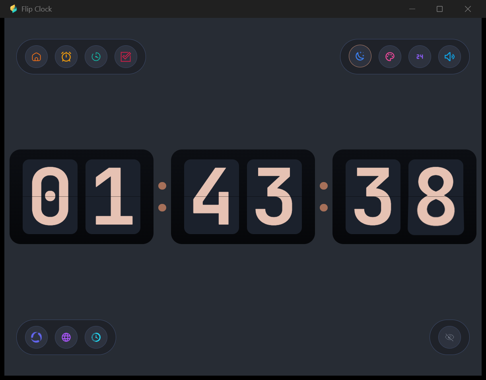
  <br />
  <sub>Windows | Linux | Android</sub>
</p>

---

## 📥 下载 | Download

| 平台 / Platform | 产物 / Artifacts                                | 自动更新 / Auto-update |
| --------------- | ----------------------------------------------- | :--------------------: |
| **Windows**     | `FlipClock_<ver>_x64-setup.exe` (NSIS) / `.msi` |           ✅           |
| **Linux**       | `FlipClock_<ver>_amd64.AppImage` / `.deb`       |           ✅           |
| **Android**     | `FlipClock-<ver>-android-universal.apk`         |     ✅（提示下载）     |

<p align="center">
  <a href="https://github.com/bimomid/Flip-Clock/releases/latest"><b>👉 前往 Releases 下载 | Download the latest build</b></a>
</p>

---

## ✨ 功能 | Features

|     | 中文                                            | English                                                               |
| --- | ----------------------------------------------- | --------------------------------------------------------------------- |
| 🕰️  | **翻页时钟** — 经典翻页动画，可选翻页音效       | **FlipClock** — classic flip animation with optional tick sound       |
| ⏳  | **专注计时** — 番茄钟倒计时，环形进度与闹铃     | **Focus Timer** — Pomodoro countdown with ring progress and alarm     |
| ⏱️  | **秒表** — 高精度计时，支持计圈 / 分段          | **Stopwatch** — high-precision timing with laps and splits            |
| 📝  | **任务便签** — 可拖拽、可缩放的悬浮记事本       | **Notepad** — draggable, resizable floating notepad                   |
| 🧩  | **图标坞** — 拖拽排序，6 种停靠位置，可自动隐藏 | **Dock** — drag-to-reorder toolbar, 6 anchors, auto-hide              |
| 🎨  | **主题** — 深色 / 浅色 + 调色板，圆形扩散过渡   | **Theme** — dark / light with palettes and circular reveal transition |
| 🕛  | **时间格式** — 12 / 24 小时制一键切换           | **Time format** — 12h / 24h toggle                                    |
| 🌐  | **多语言** — English / 中文，首次启动跟随系统   | **i18n** — English / 中文, follows system locale on first launch      |

---

## 📸 截图 | Screenshots

<div align="center">
  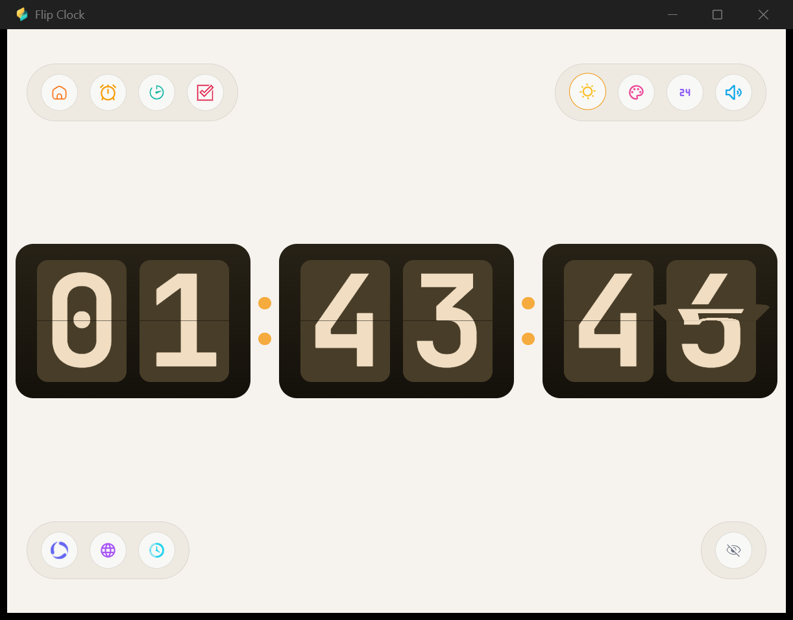
  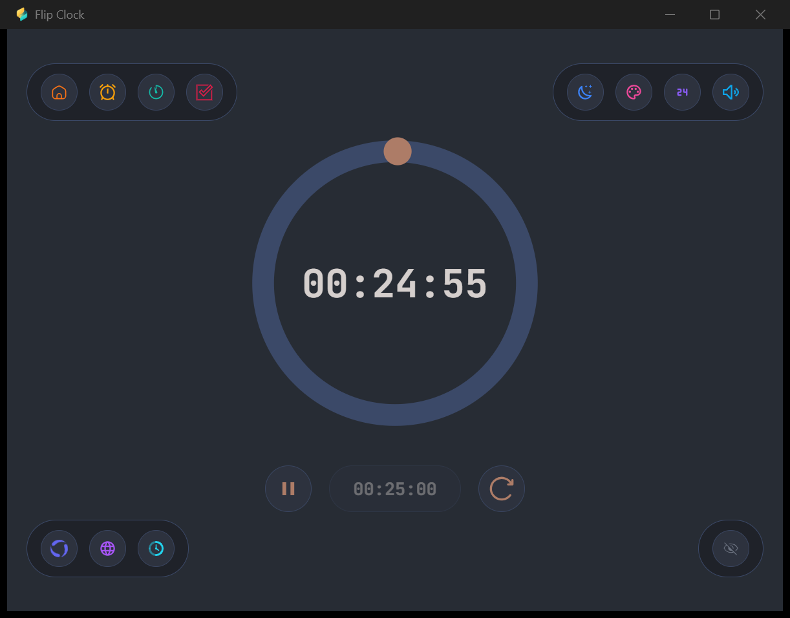
  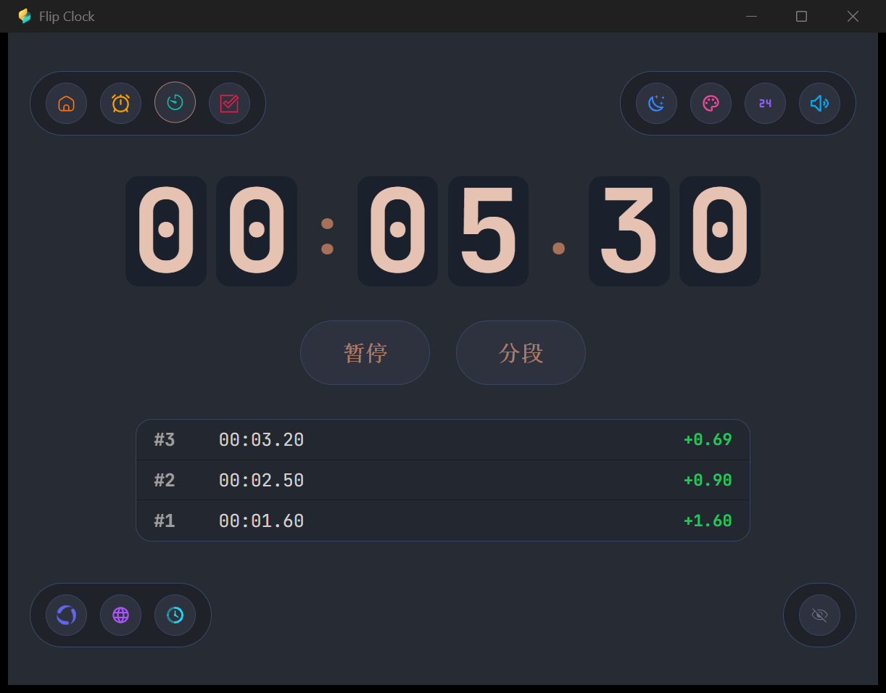
  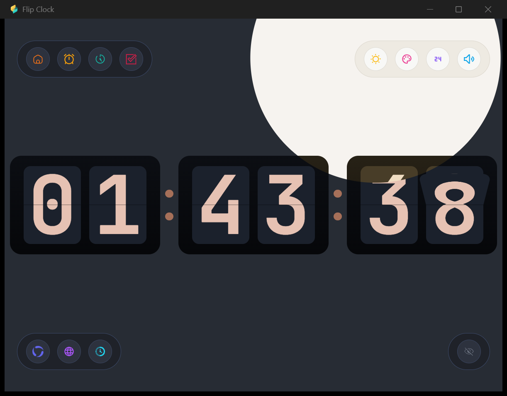
  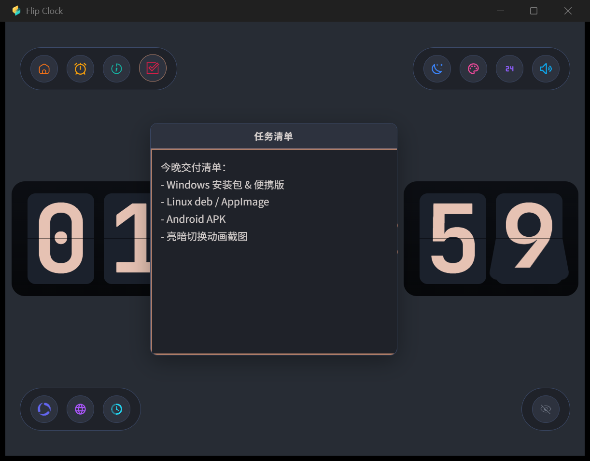
  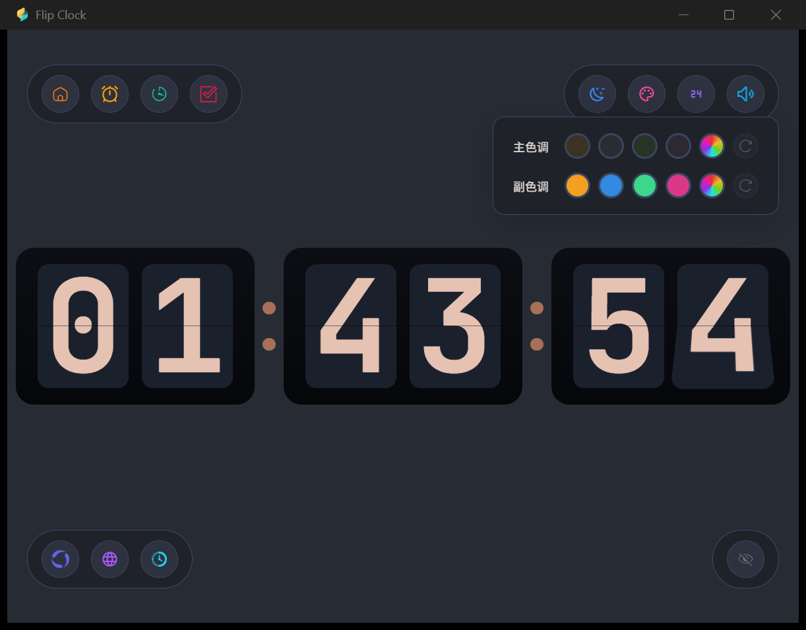
  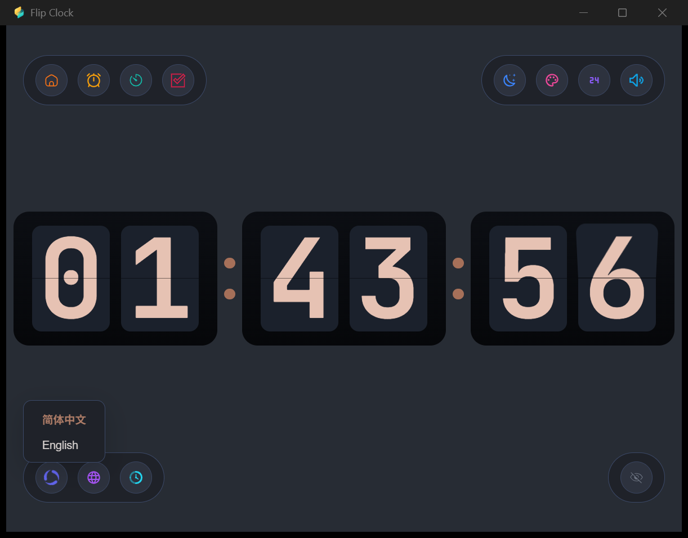
  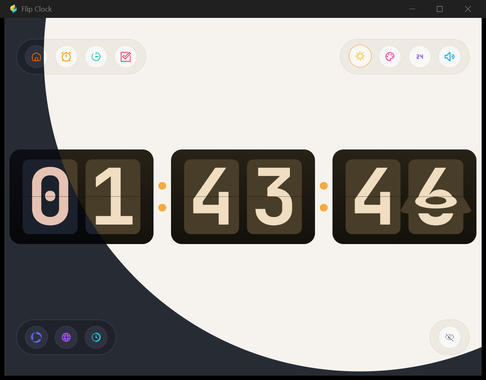
</div>

<p align="center">
  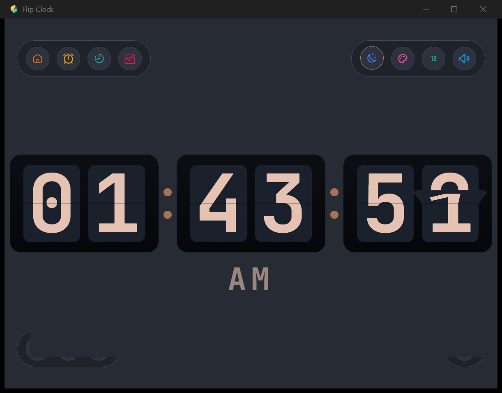
</p>

<p align="center">
  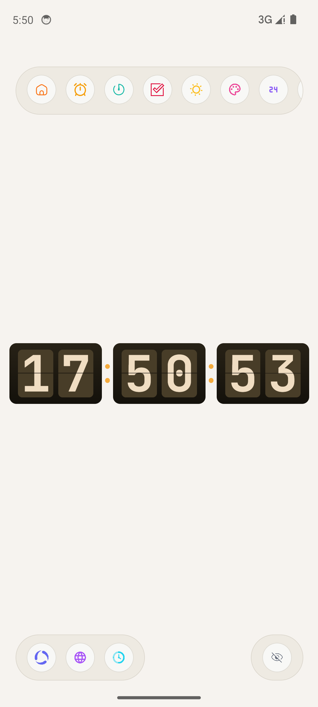
</p>

---

## 🛠 技术栈 | Tech Stack

| 类别 / Category       | 选型 / Stack                                       |
| --------------------- | -------------------------------------------------- |
| 🧩 框架 / Framework   | Vue 3 (Composition API) + TypeScript               |
| 🦀 桌面 / Desktop     | Tauri 2 (Rust)                                     |
| 🗃️ 状态 / State       | Pinia + persisted state                            |
| 🌐 国际化 / i18n      | vue-i18n                                           |
| 🎨 样式 / Styles      | SCSS + CSS custom properties                       |
| ⚙️ 工具链 / Toolchain | Vite+ (Vite 8 + Oxlint + Oxfmt), Vitest, Stylelint |

---

## 🚀 开始 | Getting Started

### 📦 环境要求 | Requirements

| 依赖 / Dependency        | 版本 / Version   | 说明 / Notes                                      |
| ------------------------ | ---------------- | ------------------------------------------------- |
| Node.js                  | ≥ 24             | CI 使用 24 / CI runs on 24                        |
| pnpm                     | ≥ 10             | 仅接受 pnpm / pnpm only（`only-allow` 校验）      |
| Rust                     | stable（≥ 1.90） | updater 需要 / required by `tauri-plugin-updater` |
| 平台依赖 / Platform deps | —                | 见下 / see below                                  |

- **Windows** — Microsoft C++ Build Tools（“使用 C++ 的桌面开发”）+ WebView2 Runtime
- **Linux** — `libwebkit2gtk-4.1-dev libappindicator3-dev librsvg2-dev patchelf`
- **Android**（可选 / optional）— JDK 21 + Android SDK / NDK，首次执行 `pnpm tauri android init`

### ⌨️ 常用命令 | Commands

```bash
pnpm install        # 安装依赖 | install dependencies
pnpm dev            # 浏览器开发 | browser dev (http://localhost:1420)
pnpm tauri dev      # 桌面端开发 | desktop dev with HMR
pnpm build          # 构建前端 | build frontend
pnpm tauri build    # 构建桌面安装包 | build installers

pnpm check          # 格式 + lint + 类型 | format, lint, types
pnpm check:fix      # 自动修复 | fix in place
pnpm test           # 单元测试 | unit tests
pnpm test:watch     # 监听模式 | watch mode
pnpm version:check  # 校验三处版本号 | verify version sync
pnpm commit         # 交互式提交 | guided commit
```

> 发版与 CI 细节见 [docs/RELEASE.md](docs/RELEASE.md)。

---

## 📁 目录结构 | Project Structure

```
src/
├── components/    # Vue 组件 | components
├── composables/   # 组合式函数 | composition functions
├── config/        # 静态配置表 | static config tables
├── layouts/       # 页面布局 | page layouts
├── languages/     # 词条定义 | i18n definitions
├── services/      # 平台桥接 | platform bridges
├── stores/        # Pinia stores
├── styles/        # 全局样式与主题变量 | global styles and theme tokens
├── utils/         # 纯函数 | pure helpers
├── assets/        # 静态资源 | static assets (svg, mp3)
└── main.ts        # 入口 | entry
tests/             # 全部测试 | all tests
src-tauri/         # Tauri（Rust）后端 | backend
```

---

## 📄 许可 | License

本项目采用 [PolyForm Noncommercial 1.0.0](LICENSE)：允许个人学习、研究、修改与非商业分发，**禁止商业使用**。

Licensed under the [PolyForm Noncommercial 1.0.0](LICENSE): personal, educational, research and noncommercial
use is allowed, **commercial use is not**. This is a source-available license, not an OSI-approved open source license.

---

<p align="center">
  <sub>Made with ❤️ by <a href="https://github.com/bimomid">bimomid</a> | Vue 3 + Tauri</sub>
</p>
